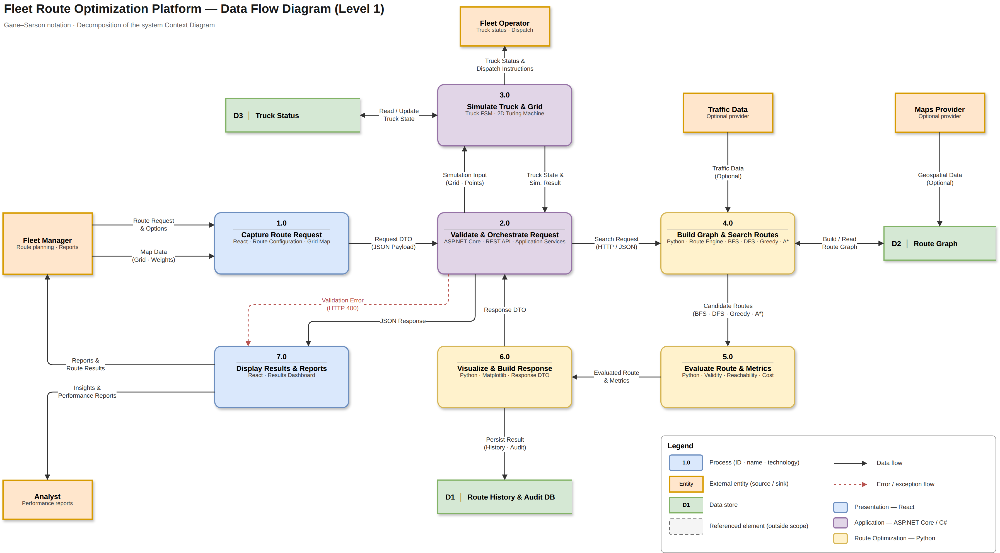
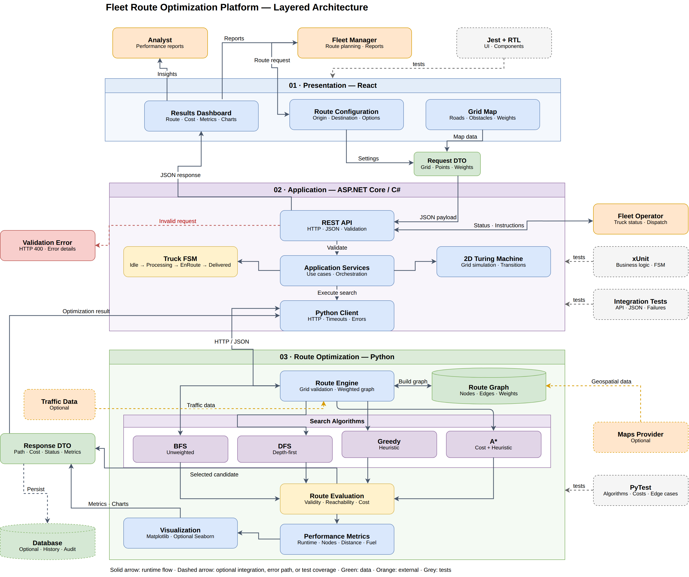
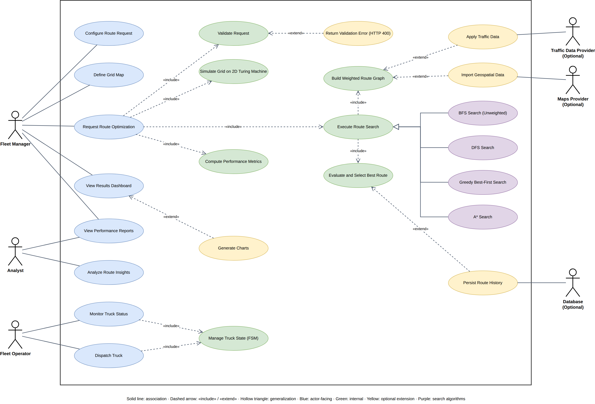

# Smart NavX — Project Proposal

> Complete Markdown conversion of the supplied Word document. Embedded images are extracted unchanged into the accompanying `Smart_NavX_assets/` folder and linked below where detected.

|  10th of Ramadan City  ·  Egypt **FACULTY OF COMPUTER SCIENCE & INFORMATION TECHNOLOGY** |
| --- |
| **PROJECT PROPOSAL** **Smart NavX** Hybrid .NET & Python Supply Chain Route Optimizer Intelligent route planning with BFS, DFS, Greedy and A*, governed by a Finite State Machine and verified by a 2D Turing Machine. |
|  |

| **PROJECT TITLE** | **Smart NavX: Hybrid .NET & Python Supply Chain Route Optimizer** |
| --- | --- |
| **SUBMITTED BY** | Noureddine Osama Nour  ·  ID: #24030259 |
| **ACADEMIC SUPERVISOR** | Dr. Fady Salama |
| **DEPARTMENT HEAD** | Prof. Ahmed Nagm |
| **PROGRAM / DEPARTMENT** | [Computer Science / Software Engineering] |
| **ACADEMIC YEAR** | 2026 / 2027 |
| **SUBMISSION DATE** | October 2026 |
| **VERSION** | 1.0 – Final Proposal |

**Table of Contents**

| **01** | Executive Summary |
| --- | --- |
| **02** | Introduction and Background |
| **03** | Problem Statement |
| **04** | Vision, Goals and Objectives |
| **05** | Project Scope |
| **06** | Stakeholders |
| **07** | Proposed Solution |
| **08** | System Architecture |
| **09** | Main Features |
| **10** | Technical Design |
| **11** | Requirements |
| **12** | Technology Stack |
| **13** | Testing and QA Strategy |
| **14** | Methodology and Project Plan |
| **15** | Team Roles and Deliverables |
| **16** | Risk Analysis |
| **17** | Expected Results and Success Metrics |
| **18** | Academic and Innovation Value |
| **19** | Future Work |
| **20** | Conclusion |
| **21** | References |

## 01  Executive Summary

In modern supply chains, delivery cost and delivery time decide whether a logistics company is profitable. Fleet managers must continuously choose routes through cities where traffic congestion, accidents and road closures change from hour to hour. Choosing a route by intuition, or with an algorithm that ignores road cost, wastes fuel, time and money.

**Smart NavX** is a hybrid, interactive route-optimization platform that models a city as a weighted grid map and computes the best truck route between a warehouse and a customer. The system runs four classic search algorithms (**BFS, DFS, Greedy Best-First and A***) on the same map and compares them using real cost metrics: fuel consumed, nodes explored and processing time.

What makes the project distinctive is its **three-tier hybrid architecture** and its **formal computational foundation**:

A **React** web dashboard lets a fleet manager draw the city map, place warehouses and customers, and view results.

A **.NET Core (C#)** backend controls the truck and order lifecycle with a **Finite State Machine (FSM)** and validates map reachability with a **2D Turing Machine** model.

A **Python** engine executes the four algorithms and generates performance charts with **Matplotlib / Seaborn**.

Quality is guaranteed with **Jest** (frontend), **xUnit** (backend) and **pytest** (algorithms).

| **One-line pitch** Smart NavX turns route planning from guesswork into a measurable, explainable and testable engineering decision. |
| --- |

## 02  Introduction and Background

Supply chain logistics covers the movement of goods from warehouses to distribution points and finally to customers. Last-mile and regional delivery are the most expensive segments, and fuel and driver time account for a large share of operating cost. Optimizing routes is therefore one of the highest-impact improvements a logistics company can make.

Route planning is, at its core, a **graph search problem**: a city is a graph, intersections are nodes, roads are edges, and each road has a cost. Artificial intelligence offers well-studied search algorithms for this problem, but students and practitioners often study them in isolation and on unweighted examples such as mazes. Real roads are not equal. A congested road costs more than an open road, and a closed road cannot be used at all.

Smart NavX bridges that gap by placing the algorithms in a realistic, interactive logistics setting, wrapped in professional software engineering practices.

## 03  Problem Statement

### 3.1 The Problem

| **#** | **Problem** | **Business Impact** |
| --- | --- | --- |
| P1 | **Cost-blind routing.** Many simple routing methods find a path but ignore congestion and road cost. | Higher fuel consumption and delivery delays. |
| P2 | **No way to compare algorithms.** Teams cannot easily see why one algorithm outperforms another on the same map. | Poor decisions and unexplainable results. |
| P3 | **Unsafe operational workflow.** A truck may be dispatched before a valid route exists, or two operations may overlap. | Failed deliveries and inconsistent order status. |
| P4 | **Weak transparency and quality assurance.** Academic prototypes are rarely tested or formally modeled. | Low reliability and low trust in the results. |

### 3.2 Problem Statement

| **Research question** How can a logistics company automatically find, compare and validate the most cost-effective truck route across a city containing open roads, traffic congestion and blocked roads, while keeping the dispatch workflow safe, the computation explainable and the whole system thoroughly tested? |
| --- |

### 3.3 Gap in Existing Solutions

Commercial navigation tools are closed-source and do not expose how routes are computed.

Typical academic projects (maze solvers, single-algorithm demos) use unweighted grids and ignore operational workflow.

Few projects connect **algorithm theory, formal computation models and production-style testing** in one system.

## 04  Vision, Goals and Objectives

### 4.1 Vision

To provide an intelligent, transparent and testable route-optimization platform that helps logistics managers make cost-saving routing decisions, and that serves as a complete reference implementation of AI search, formal computation theory and hybrid software architecture.

### 4.2 Main Goal

Design, build and evaluate a hybrid .NET, Python and Web system that automatically selects the lowest-cost delivery route among four search algorithms and presents the comparison visually.

### 4.3 SMART Objectives

| **ID** | **Objective** | **Measure of Success** | **Target** |
| --- | --- | --- | --- |
| O1 | Implement BFS, DFS, Greedy and A* on a weighted grid. | Each returns a valid path or a correct "no path" result. | 100% of test maps |
| O2 | Show that A* gives the lowest-cost path on congested maps. | A* cost is less than or equal to every other algorithm. | All benchmark maps |
| O3 | Model the truck lifecycle as a protected FSM. | Illegal transitions are rejected. | 0 accepted |
| O4 | Verify reachability with a 2D Turing Machine model. | Machine always halts in Halt_Success or Halt_Failure. | 0 infinite loops |
| O5 | Provide an interactive map editor and dashboard. | Map creation to result without leaving the page. | Under 60 seconds |
| O6 | Generate automatic performance charts. | Fuel, nodes explored and time per algorithm. | 3 metrics × 4 algorithms |
| O7 | Reach high automated test coverage. | Coverage of core logic. | 80% or more |
| O8 | Return results quickly on typical maps. | Response time on a 50 × 50 grid. | Under 3 seconds |

## 05  Project Scope

### 5.1 In Scope

A 2D grid-based city model with five cell types (warehouse, customer, open road, congestion, blocked road).

Single truck, single warehouse to single customer routing, with multi-customer routing as a stretch goal.

Four search algorithms: BFS, DFS, Greedy Best-First Search and A*.

A cost model based on cell weight (fuel proxy).

FSM-controlled truck and order lifecycle, and a 2D Turing Machine formalization of the reachability check.

Interactive React dashboard with drawing tools, live results, charts and a recommended-route summary.

Automated tests across all three layers and technical documentation.

### 5.2 Out of Scope

Real GPS or live traffic data integration.

Mobile applications.

Multi-vehicle optimization and the full Vehicle Routing Problem (VRP).

Payment, billing or customer account management.

Cloud production deployment (a local or containerized demo only).

### 5.3 Assumptions and Constraints

| **Assumptions** | **Constraints** |
| --- | --- |
| The city can be approximated by a rectangular grid with four-direction movement. | Academic timeline of one semester (about 16 weeks). |
| Congestion has a fixed higher weight (5); blocked roads are impassable. | Student team with limited budget; only free and open-source tools. |
| The user supplies the map; no external map service is used. | Must run on standard student hardware. |

## 06  Stakeholders

| **Stakeholder** | **Role** | **Interest / Expectation** | **Influence** |
| --- | --- | --- | --- |
| **Fleet / Logistics Manager** | Primary user | Fast, cost-saving, easy-to-understand routes. | High |
| **Dispatcher / Operator** | Day-to-day user | Safe workflow with clear truck and order status. | Medium |
| **Logistics Company Owner** | Business sponsor | Lower fuel cost, higher on-time delivery. | High |
| **Project Team** | Developers and testers | Deliver a high-quality, well-documented system. | High |
| **Academic Supervisor** | Guidance and evaluation | Technical depth, originality, correct theory. | High |
| **Examination Committee** | Final evaluation | Clear problem, visual design, working demo. | High |
| **Innovation University** | Institution | Innovative, practical student work. | Medium |
| **Future Students** | Secondary users | A reusable, open reference project. | Low |

## 07  Proposed Solution

Smart NavX is built as three cooperating layers, each responsible for what it does best:

**Presentation layer (React).** The manager draws the map, selects the warehouse and customer, and presses **Optimize Route**.

**Control and theory layer (.NET Core).** The backend validates the request, drives the FSM, runs the 2D Turing Machine reachability check, and only then calls the algorithm engine.

**Intelligence layer (Python).** The engine runs BFS, DFS, Greedy and A* on the same map, measures performance, picks the best route and produces charts.

### 7.1 End-to-End Workflow

| **Step** | **Actor** | **Action** |
| --- | --- | --- |
| 1 | Manager | Draws the map and places warehouse and customer. |
| 2 | React | Validates input (a customer must exist) and sends a JSON request. |
| 3 | .NET | Receives the request; truck moves from Idle to Processing. |
| 4 | .NET | 2D Turing Machine checks that the customer is reachable. |
| 5 | Python | Runs all four algorithms and collects metrics. |
| 6 | .NET | On success, truck moves to EnRoute; stores the best route. |
| 7 | React | Shows path, metrics and charts; animates the truck. |
| 8 | .NET | On arrival, truck moves to Delivered. |

### 7.2 Data Flow Diagram (Level 1)

Figure 1 decomposes Smart NavX into seven processes, three data stores and the external entities that exchange data with the system, using Gane–Sarson notation. It shows how a route request travels from the React interface through the .NET orchestration layer to the Python engine and returns as an evaluated result.

**Figure 1 — ***Data Flow Diagram (Level 1)*

## 08  System Architecture

| **LAYER 1  ·  Web Interface  (React + Jest)** Interactive grid map editor and truck tracking Results dashboard and live charts |
| --- |

**▼  REST API  (JSON)**

| **LAYER 2  ·  Backend Engine  (.NET Core, C#, xUnit)** Request validation and API endpoints Finite State Machine: truck and order lifecycle 2D Turing Machine: map reachability verification |
| --- |

**▼  Internal process / service call**

| **LAYER 3  ·  Algorithm Engine  (Python, pytest)** BFS, DFS, Greedy Best-First, A* Fuel cost, nodes explored, execution time Matplotlib / Seaborn chart generation |
| --- |

Figure 2 expands the three-layer view into its main components. It shows the runtime flow between the React dashboard, the ASP.NET Core application layer and the Python optimization engine, together with the external actors, optional integrations and test suites around them.

**Figure 2 — ***Context Diagram*

### 8.1 Layer Responsibilities

| **Layer** | **Main Responsibility** | **Why This Technology** |
| --- | --- | --- |
| Web (React) | User experience, map drawing, visualization | Component-based, fast, widely used, easy to test with Jest. |
| Backend (.NET Core) | Orchestration, state safety, formal verification | Strong typing, reliability and mature testing with xUnit. |
| Algorithms (Python) | Search algorithms and analytics | Rapid development and excellent visualization libraries. |

### 8.2 Design Principles

**Separation of concerns:** each layer has one clear job.

**Loose coupling:** layers communicate only through JSON contracts.

**Testability:** every layer can be tested independently.

**Explainability:** every result can be traced to a measurable cost.

## 09  Main Features

| **ID** | **Feature** | **Description** | **Priority** |
| --- | --- | --- | --- |
| F1 | **Interactive Map Editor** | Draw roads, congestion and blocked cells with the mouse. | Must |
| F2 | **Cell Type Legend** | Warehouse (green), customer (red), open road (white, 1), congestion (orange, 5), blocked (black). | Must |
| F3 | **Four-Algorithm Comparison** | Run BFS, DFS, Greedy and A* on the same map in one click. | Must |
| F4 | **Best-Route Selection** | The system recommends the lowest-cost valid route. | Must |
| F5 | **FSM Dispatch Control** | Idle, Processing, EnRoute, Delivered with guarded transitions. | Must |
| F6 | **Turing Machine Check** | Formal reachability verification with guaranteed termination. | Must |
| F7 | **Performance Dashboard** | Bar charts for fuel cost, nodes explored and processing time. | Must |
| F8 | **Input Validation** | Friendly error when optimizing without a customer location. | Must |
| F9 | **Route Animation** | Animated truck movement along the chosen path. | Should |
| F10 | **Save / Load Maps** | Export and import map layouts as JSON. | Should |
| F11 | **Random Map Generator** | Benchmark maps with a chosen congestion percentage. | Should |
| F12 | **Multi-Customer Routing** | Visit several customers in an efficient order. | Could |
| F13 | **Exportable Report** | Download the comparison as PDF or CSV. | Could |

## 10  Technical Design

### 10.1 Map Model

The city is a two-dimensional array of cells. Movement is allowed in four directions, and the cost of entering a cell equals its weight.

| **Symbol** | **Meaning** | **Color** | **Weight** |
| --- | --- | --- | --- |
| S | Warehouse (start) | Green | 0 |
| G | Customer (goal) | Red | 0 |
| W | Open road | White | 1 |
| T | Traffic congestion | Orange | 5 |
| B | Blocked road or accident | Black | Infinity |
| V | Visited (verifier marker) | Grey | n/a |

### 10.2 Finite State Machine (FSM)

The FSM guarantees that logistics operations never overlap and that a truck is never dispatched without a valid route. Any event not listed for a state is rejected and logged, which makes illegal transitions impossible.

| **Current State** | **Event** | **Guard Condition** | **Next State** |
| --- | --- | --- | --- |
| Idle | RequestRoute | Map is valid and customer exists | Processing |
| Processing | RouteFound | Reachable and algorithm returned success | EnRoute |
| Processing | RouteFailed | No route exists | Idle |
| EnRoute | Arrived | Truck reached the customer cell | Delivered |
| Delivered | Reset | New order requested | Idle |

### 10.3 2D Turing Machine for Reachability

The reachability check is formalized as a Turing Machine whose tape is two-dimensional. This gives the project a rigorous theoretical foundation and a provable termination argument.

**Formal definition:** M = (Q, Σ, Γ, δ, q₀, q_accept, q_reject)

| **Component** | **Definition in Smart NavX** |
| --- | --- |
| **Tape** | The 2D character array char[,] representing the map. |
| **Alphabet Γ** | W, T, B, V, S, G |
| **Head** | A pointer (row, column) moving Up, Down, Left or Right. |
| **States Q** | Moving_Forward, Moving_Backtrack, Halt_Success, Halt_Failure |
| **Transition δ** | Read symbol, write symbol, move direction, next state. |

| **Read** | **Write** | **Move** | **Next State** |
| --- | --- | --- | --- |
| W or T | V | Next unexplored direction | Moving_Forward |
| B or V | unchanged | Reverse | Moving_Backtrack |
| G | unchanged | None | Halt_Success |
| Back at start, no options | unchanged | None | Halt_Failure |

| **Termination argument** Each non-blocked cell is marked V at most once, so the number of write operations is bounded by rows × columns. The machine therefore always halts. |
| --- |

### 10.4 Search Algorithms

All four algorithms run on the identical map so the comparison is fair.

| **Algorithm** | **Strategy** | **Uses Cost?** | **Optimal (weighted)?** | **Expected Behavior** |
| --- | --- | --- | --- | --- |
| **BFS** | Level by level | No | No | May cross congested cells. |
| **DFS** | Deepest first | No | No | Often long, expensive paths. |
| **Greedy** | Heuristic only | Heuristic | No | Fast but can be misled. |
| **A*** | f(n) = g(n) + h(n) | Yes | **Yes** | Detours around congestion to minimize cost. |

A* uses the **Manhattan distance** heuristic, which is admissible on a four-direction grid whose minimum step cost is 1, so A* is guaranteed to return a minimum-cost path.

### 10.5 Performance Metrics

| **Metric** | **Definition** |
| --- | --- |
| **Fuel Cost** | Sum of cell weights along the returned path. |
| **Path Length** | Number of cells in the path. |
| **Nodes Explored** | Cells expanded before the algorithm stopped. |
| **Processing Time** | Execution time in milliseconds. |

### 10.6 API Contract (Summary)

| **Endpoint** | **Method** | **Purpose** |
| --- | --- | --- |
| /api/route/optimize | POST | Submit map, start and goal; returns results for all four algorithms. |
| /api/truck/{id}/state | GET | Current FSM state of a truck. |
| /api/map/validate | POST | Run the Turing Machine reachability check only. |
| /api/report/{id} | GET | Retrieve charts and the comparison summary. |

## 11  Requirements

### 11.1 Functional Requirements

| **ID** | **Requirement** |
| --- | --- |
| FR1 | The system shall let the user draw and edit a grid map with five cell types. |
| FR2 | The system shall reject an optimization request when no customer is selected and show a clear error message. |
| FR3 | The system shall verify reachability before running the algorithms. |
| FR4 | The system shall run BFS, DFS, Greedy and A* and return path, cost, nodes explored and time for each. |
| FR5 | The system shall recommend the lowest-cost valid route. |
| FR6 | The system shall manage truck status through the FSM and reject invalid transitions. |
| FR7 | The system shall display comparison charts after each run. |
| FR8 | The system shall report clearly when no route exists. |

### 11.2 Non-Functional Requirements

| **Category** | **Requirement** |
| --- | --- |
| **Performance** | A 50 × 50 map is solved in under 3 seconds. |
| **Reliability** | The verifier and algorithms never enter an infinite loop. |
| **Usability** | A new user can complete a route request without training. |
| **Maintainability** | Modular code, documented interfaces, consistent style. |
| **Testability** | 80% or more coverage of core logic. |
| **Security** | Input validation and size limits on all API requests. |
| **Portability** | Runs on Windows, Linux and macOS using free tools. |

### 11.3 Use Case Diagram

Figure 3 summarizes the functional requirements as use cases. The Fleet Manager, Analyst and Fleet Operator interact with the system, while the optional Traffic Data Provider, Maps Provider and Database extend it. The four search algorithms specialize the Execute Route Search use case.

**Figure 3 — ***Use Case Diagram*

## 12  Technology Stack

| **Area** | **Technology** |
| --- | --- |
| Frontend | React, JavaScript / TypeScript, CSS |
| Frontend testing | Jest, React Testing Library |
| Backend | .NET Core (ASP.NET Core Web API), C# |
| Backend testing | xUnit |
| Algorithm engine | Python 3 |
| Algorithm testing | pytest |
| Data visualization | Matplotlib, Seaborn |
| Communication | REST with JSON |
| Version control | Git and GitHub |
| Project management | Trello or Jira |
| Optional packaging | Docker |

## 13  Testing and QA Strategy

| **Layer** | **Tool** | **What Is Tested** |
| --- | --- | --- |
| Web | Jest + React Testing Library | Map rendering, input validation, button behavior, edge cases. |
| Backend | xUnit | FSM transitions, Turing Machine writes and termination, API responses. |
| Algorithms | pytest | Correctness and optimality on benchmark maps. |
| Integration | End-to-end scripts | Full request from React to .NET to Python and back. |

### 13.1 Sample Test Cases

| **ID** | **Layer** | **Scenario** | **Expected Result** |
| --- | --- | --- | --- |
| T1 | Jest | Map component renders. | Warehouse node is present. |
| T2 | Jest | Optimize clicked without a customer. | Error shown; API function not called. |
| T3 | xUnit | FSM receives Arrived while Idle. | Transition rejected. |
| T4 | xUnit | Customer enclosed by blocked cells. | Machine ends in Halt_Failure. |
| T5 | xUnit | Large open map. | Machine halts within the cell-count bound. |
| T6 | pytest | Congestion band across the direct path. | A* cost ≤ BFS, DFS and Greedy cost. |
| T7 | Integration | Valid map submitted from the UI. | Dashboard shows path, table and three charts. |

### 13.2 Quality Gates

All tests must pass before code is merged.

Code review by at least one other team member.

Coverage report generated for each layer.

## 14  Methodology and Project Plan

The team will follow an **Agile (Scrum-style) methodology** with two-week sprints, a backlog built from the features in Section 09, and a demo at the end of each sprint.

| **Phase** | **Weeks** | **Activities** | **Deliverable** |
| --- | --- | --- | --- |
| 1. Analysis & Design | 1 – 2 | Requirements, architecture, wireframes, API contract. | Approved design document |
| 2. Algorithm Engine | 3 – 5 | Implement and unit-test BFS, DFS, Greedy, A*; metrics. | Working Python engine |
| 3. Backend Core | 6 – 8 | .NET API, FSM, 2D Turing Machine, xUnit tests. | Tested backend |
| 4. Frontend | 9 – 11 | React map editor, dashboard, Jest tests. | Interactive web app |
| 5. Integration | 12 – 13 | Connect layers, generate charts, fix defects. | Integrated system |
| 6. Testing & Evaluation | 14 | Benchmark maps, performance and usability tests. | Evaluation report |
| 7. Documentation & Defense | 15 – 16 | Final report, user guide, demo preparation. | Final documentation and presentation |

## 15  Team Roles and Deliverables

### 15.1 Suggested Roles

| **Role** | **Responsibilities** | **Owner** |
| --- | --- | --- |
| Project Manager & Integration Lead | Planning, sprint management, cross-layer integration. | [Name] |
| Backend Engineer | .NET API, FSM, Turing Machine, xUnit. | [Name] |
| Algorithm & Data Engineer | Python algorithms, metrics, charts, pytest. | [Name] |
| Frontend Engineer | React UI, Jest tests, user experience. | [Name] |

### 15.2 Final Deliverables

Complete source code in a version-controlled repository.

Running demo of the integrated system.

Technical documentation and API reference.

Test reports and coverage results.

User guide, final report and defense presentation.

## 16  Risk Analysis

| **ID** | **Risk** | **Probability** | **Impact** | **Mitigation** |
| --- | --- | --- | --- | --- |
| R1 | Integration difficulty between .NET and Python. | Medium | High | Define the JSON contract early; thin integration prototype in week 5. |
| R2 | Slow performance on large grids. | Medium | Medium | Efficient data structures (priority queues); limit grid size; benchmark early. |
| R3 | Team member unavailable. | Low | High | Shared documentation, pair programming, cross-training. |
| R4 | Scope creep. | Medium | Medium | Build "Must" features first; defer "Could" features. |
| R5 | Algorithm or theory errors. | Low | High | Test against hand-computed maps; supervisor review. |
| R6 | Library version conflicts. | Low | Low | Pin dependency versions; use Docker if needed. |

## 17  Expected Results and Success Metrics

### 17.1 Expected Outcomes

A working platform that visibly shows A* avoiding congestion while BFS and DFS ignore road cost.

Quantified evidence, in charts and tables, of fuel savings from cost-aware routing.

A provably safe dispatch workflow with zero illegal state transitions.

A formally modeled, guaranteed-terminating reachability check.

### 17.2 Key Performance Indicators

| **KPI** | **Target** |
| --- | --- |
| A* cost versus the best of BFS, DFS and Greedy | Equal or lower on 100% of benchmark maps |
| Average fuel saving of A* versus BFS on congested maps | Measured and reported (target 15% or more) |
| Automated test pass rate | 100% |
| Core logic code coverage | 80% or more |
| End-to-end response time (50 × 50 grid) | Under 3 seconds |
| User task success in usability test | 90% or more |

## 18  Academic and Innovation Value

| **Academic Area** | **Where It Appears in the Project** |
| --- | --- |
| Artificial Intelligence / Search | BFS, DFS, Greedy, A*, heuristics, admissibility |
| Theory of Computation | FSM and 2D Turing Machine formalization |
| Software Engineering | Agile process, architecture, requirements, QA |
| Web Development | React interactive interface |
| Software Testing | Jest, xUnit, pytest, integration testing |
| Data Analysis and Visualization | Matplotlib and Seaborn performance reports |
| Logistics and Supply Chain | Cost modeling and route decision support |

### Why This Project Is Innovative

**Beyond the typical maze solver:** weighted costs, congestion and blocked roads simulate real logistics decisions.

**Theory meets practice:** formal models (FSM, Turing Machine) are working components, not just textbook examples.

**Hybrid architecture:** three technologies cooperate through clear contracts, mirroring professional industry systems.

**Quality-first mindset:** testing is planned at every layer from day one.

## 19  Future Work

Add **Dijkstra / Uniform Cost Search** as a fifth algorithm and an optimality baseline.

Support **multi-truck fleets** and the Vehicle Routing Problem.

Import **real map and live traffic data** (for example, OpenStreetMap-based sources).

Add **dynamic re-routing** when a new accident appears during a trip.

Introduce **machine learning** to predict congestion by time of day.

Provide **cloud deployment** with user accounts and saved fleets.

## 20  Conclusion

Smart NavX addresses a real logistics problem, the cost of choosing poor routes, with a solution that is practical, explainable and rigorously engineered. By combining a React dashboard, a .NET Core backend governed by an FSM and a 2D Turing Machine, and a Python engine running four search algorithms with automatic analytics, the project delivers both measurable business value and strong academic depth. With a clear scope, a realistic 16-week plan, identified risks and a layered testing strategy, the project is well prepared for successful delivery and defense at Innovation University, Egypt.

## 21  References

Russell, S. and Norvig, P. Artificial Intelligence: A Modern Approach, 4th ed., Pearson, 2020.

Hart, P. E., Nilsson, N. J. and Raphael, B. "A Formal Basis for the Heuristic Determination of Minimum Cost Paths," IEEE Transactions on Systems Science and Cybernetics, 1968.

Sipser, M. Introduction to the Theory of Computation, 3rd ed., Cengage, 2012.

Microsoft. ASP.NET Core Documentation and xUnit.net Documentation.

Meta. React Documentation; OpenJS Foundation. Jest Documentation.

Hunter, J. D. "Matplotlib: A 2D Graphics Environment," Computing in Science & Engineering, 2007.

**APPROVAL**

| **Role** | **Name** | **Signature** | **Date** |
| --- | --- | --- | --- |
| Team Leader | Noureddine Osama Nour (ID: #24030259) |  |  |
| Academic Supervisor | Dr. Fady Salama |  |  |
| Department Head | Prof. Ahmed Nagm |  |  |

## Appendix — Additional embedded document assets

