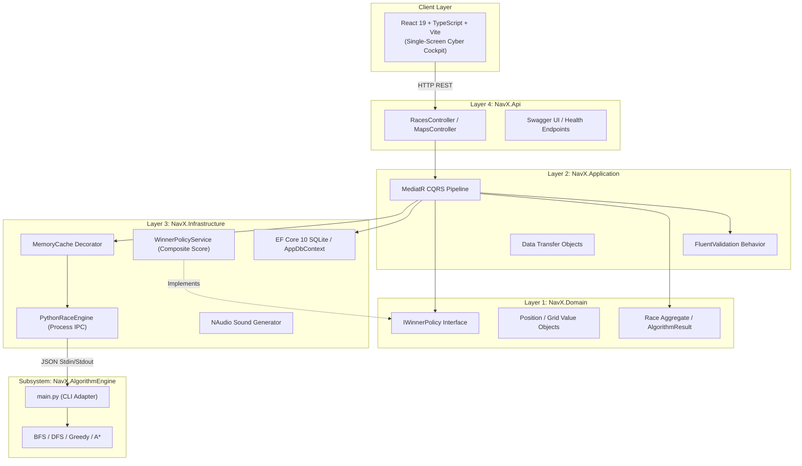

# 🏁 NavX Arena — Multi-Algorithm Search Race Platform

<p align="center">
  
  
  
  
  
  
  
  
</p>

---

## 📖 Executive Summary

**NavX Arena** is a real-time, interactive pathfinding simulation and algorithmic benchmarking platform. Four fundamental computer science search algorithms (**Breadth-First Search**, **Depth-First Search**, **Greedy Best-First Search**, and **A\***) race head-to-head across weighted, dynamic city road networks.

The platform visualizes the fundamental tension in algorithmic design: **optimality vs. execution speed**. Through a responsive, cyber-cockpit telemetry dashboard, users can design custom obstacle grids, trigger simultaneous search races at adjustable simulation speeds (up to 10×), inspect step-by-step frontier exploration heatmaps, listen to spatial stereo audio sonification synthesized in real time, and analyze replay history.

Built strictly under **Clean Architecture** principles across a unified modern tech stack:
* **Core Backend**: C# / .NET 10 Web API with CQRS, MediatR, FluentValidation, and EF Core 10.
* **Algorithm Engine**: Decoupled Python 3 engine executing standard-library pathfinding via IPC.
* **Frontend Cockpit**: Single-viewport (`h-screen overflow-hidden`) React 19 + TypeScript + Vite + Tailwind CSS v4 dashboard.
* **Sound Engine**: Dual-layer audio sonification combining C# NAudio synthesis with real-time Web Audio API stereo panning.

---

## 🎯 Key Capabilities & Features

### 🏎️ 1. Multi-Agent Simultaneous Race Simulation
* **Live Grid Race**: All 4 search algorithms execute in parallel on the identical grid state.
* **Frontier Visualization**: 60fps canvas engine renders explored node heatmaps in real time with distinctive algorithm neon themes.
* **Sub-Cell Car Interpolation**: Car sprites smoothly navigate along discovered routes with turn-anticipation rotation and animated exhaust trails.
* **Variable Simulation Clock**: Run races at `½×`, `1×`, `2×`, `5×`, or `10× (MAX)` speeds, or pause and step through execution.

### 🎨 2. Interactive Map Studio & Procedural Generator
* **Paint Tools**: Custom palette to draw **Start (`S`)**, **Goal (`G`)**, **Open Roads (Cost: 1)**, **Traffic Congestion (Cost: 5)**, and **Impassable Obstacles (`-1`)**.
* **Pre-Engineered Map Presets**:
  * *Downtown Traffic Bypass*: Tests whether algorithms choose a fast congested shortcut or an optimal perimeter bypass.
  * *River Bridges*: Choke-point topology testing heuristic dead-ends and local minima recovery.
  * *Urban Maze*: Dense corridor labyrinth demonstrating DFS failure modes vs. A* efficiency.
* **Procedural Random Generator**: Generates solvable random labyrinths backed by an automated BFS connectivity verification loop.
* **Map Storage**: Save custom map layouts into the persistent SQLite database and reload them with one click.

### 🏆 3. Fair Composite Scoring Metric
Rather than judging purely by fuel or physical arrival speed, NavX Arena implements an industry-grade composite formula balancing **path quality** with **algorithmic computation efficiency**:

$$\text{Score} = 0.6 \times \left(\frac{\text{Fuel}}{\text{MaxFuel}}\right) + 0.4 \times \left(\frac{\text{Time}_{\text{ms}}}{\text{MaxTime}_{\text{ms}}}\right)$$

* **60% Weight on Fuel Cost**: Strongly rewards cost-optimal pathfinding ($A^*$).
* **40% Weight on Execution Time**: Rewards low-overhead exploration algorithms (Greedy).
* **Normalized Divisors**: Both metrics scale to $[0, 1]$, preventing one dimension from dominating unfairly.
* **Lower Score = Better**: The algorithm with the lowest composite score takes the Gold Medal (`🥇`).

### 🎧 4. Real-Time Spatial Audio Sonification
Every algorithm possesses an acoustic identity synthesized via the **Web Audio API**:
* **BFS**: Sine wave, panned hard-left (`-0.8`), steady periodic hums.
* **DFS**: Square wave, panned mid-left (`-0.3`), rapid descending cascades.
* **Greedy**: Triangle wave, panned mid-right (`+0.3`), fast pitch leaps towards the destination.
* **A\***: Sawtooth wave, panned hard-right (`+0.8`), balanced harmonic resonance.
* **Dynamic Distance Pitch**: The frequency of exploration ticks escalates dynamically based on the inverse Manhattan distance to the destination ($h$).
* **Finish Arpeggios & Victory Fanfare**: Distinct melodic chords trigger upon arrival, crowned with a victor's fanfare.

### 📊 5. Telemetry Analytics & Replay Vault
* **History Modal**: Review every race recorded in the SQLite database with timestamp, dimensions, and winner stats.
* **Full Replay**: Re-watch any historical race directly on the canvas at any speed.
* **Win-Rate Statistics**: Win percentage distribution charts for all 4 contenders.

---

## 🏛️ Clean Architecture & System Design

The application is structured into strict concentric layers adhering to Clean Architecture principles. Dependencies point **strictly inward**.

```
navx-arena/
├── Dockerfile                              # Multi-stage production container build
├── docker-compose.yml                      # Single-command stack orchestration
├── NavX.slnx                               # Solution configuration
├── data/                                   # Persistent SQLite database storage
├── docs/                                   # Architecture Decision Records (ADRs)
│   ├── ADR-001-Clean-Architecture.md
│   ├── ADR-002-CQRS-and-MediatR.md
│   ├── ADR-003-Python-Engine-IPC-Contract.md
│   └── ADR-004-Audio-Sonification-NAudio-and-WebAudio.md
├── src/
│   ├── backend/
│   │   ├── NavX.Domain/                    # Layer 1: Entities, Value Objects, Interfaces
│   │   ├── NavX.Application/               # Layer 2: CQRS Handlers, Behaviors, Validators
│   │   ├── NavX.Infrastructure/            # Layer 3: EF Core, SQLite, NAudio, IPC, WinnerPolicy
│   │   ├── NavX.Api/                       # Layer 4: ASP.NET Core 10 Web API, Controllers
│   │   └── NavX.AlgorithmEngine/           # Standalone Python 3 Pathfinding Subsystem
│   └── frontend/                           # React 19, TypeScript, Tailwind CSS v4, Web Audio
└── tests/
    ├── NavX.Domain.Tests/                  # Domain invariant & entity validation tests
    ├── NavX.Application.Tests/             # CQRS handlers, pipelines, validator tests
    ├── NavX.ArchitectureTests/             # NetArchTest Clean Architecture compliance rules
    └── NavX.Api.IntegrationTests/          # WebApplicationFactory end-to-end HTTP integration tests
```

### Layer Responsibilities



1. **`NavX.Domain`**: Pure business logic. Zero external dependencies. Holds the `Race` aggregate root, `Grid` and `Position` value objects, and domain abstractions such as `IWinnerPolicy`.
2. **`NavX.Application`**: Orchestration via CQRS (Command Query Responsibility Segregation). Contains MediatR commands (`RunRaceCommand`, `SaveMapCommand`), queries (`GetRaceHistoryQuery`, `GetStatsQuery`), validation pipelines, and DTO definitions.
3. **`NavX.Infrastructure`**: Concrete technical implementations. Contains `AppDbContext` (SQLite with automatic migrations), `WinnerPolicyService` (evaluating composite scores), `CachedRaceEngine` (in-memory caching decorator), `NAudioSoundEffectGenerator`, and `PythonRaceEngine` (process-level JSON IPC).
4. **`NavX.Api`**: Delivery mechanism. Exposes RESTful endpoints, handles CORS, hosts Swagger OpenAPI documentation, and serves the static production React assets from `/wwwroot`.
5. **`NavX.AlgorithmEngine`**: Pure Python 3 search engine. Communicates via standard input/output with zero third-party pip dependencies.

---

## 📐 The Scoring & Ranking Equation (Deep Dive)

Rather than judging contenders purely on who finishes exploring first or solely on path distance, NavX Arena implements an industry-standard **Multi-Criteria Composite Score Metric**.

### 1. Mathematical Formulation

For each algorithm $i$ that discovers a valid route to the destination:

$$\text{Score}_i = w_{\text{cost}} \cdot \left(\frac{C_i}{C_{\max}}\right) + w_{\text{time}} \cdot \left(\frac{T_i}{T_{\max}}\right)$$

Where:
* $C_i$: Total cumulative **fuel cost** of the path found by algorithm $i$ ($\sum_{p \in \text{path}} \text{cost}(p)$).
* $T_i$: CPU **execution time** measured in milliseconds for algorithm $i$.
* $C_{\max} = \max_{j} (C_j)$: The maximum fuel cost among all qualifying contenders in the race.
* $T_{\max} = \max_{j} (T_j)$: The maximum execution time among all qualifying contenders in the race.
* $w_{\text{cost}} = 0.6$: Weight assigned to **Path Quality & Fuel Efficiency** (60%).
* $w_{\text{time}} = 0.4$: Weight assigned to **Computational Efficiency & Speed** (40%).
* **Lower Score = Better**: The algorithm with the lowest composite score wins the race (`🥇`).

---

### 2. Rationale & Design Trade-offs

| Strategy | Failure Mode of a Single Metric | How the 60/40 Composite Solves It |
|:---|:---|:---|
| **Pure Fuel Cost** | Ignores computational effort entirely. An algorithm exploring 10,000 nodes over 500 ms to save 1 unit of fuel would defeat an algorithm exploring 10 nodes in 0.2 ms. | Caps the fuel benefit at 60%, rewarding algorithms with lean computation. |
| **Pure Execution Time** | Ignores path safety and optimality. An erratic algorithm that plunges through high-cost traffic or hazard zones would win simply because it reached the goal in fewer hops. | Penalizes poor routes heavily by making fuel cost the dominant factor (60%). |

* **Zero-Division Safeguard**: If all algorithms produce identical costs or identical times (or if $\max = 0$), the respective divisor defaults safely to $1.0$.
* **Disqualification Rule**: Any algorithm that cannot find a path (e.g. trapped behind impassable boundaries) receives $\text{Cost} = \text{null}$ and is automatically excluded from medal placement.
* **Tie-Breaking Hierarchy**: If two algorithms produce mathematically identical composite scores, the tie is broken via deterministic algorithmic precedence:
  $$A^* \succ \text{Greedy} \succ \text{BFS} \succ \text{DFS}$$

---

### 3. Step-by-Step Calculation Walkthrough

Consider a real race on a $25 \times 18$ grid containing traffic congestion zones:
* $C_{\max} = \max(62, 226, 62, 46) = 226$
* $T_{\max} = \max(0.6, 0.3, 0.1, 2.3) = 2.3\text{ ms}$

$$\begin{aligned}
\text{Normalized Fuel Ratio} &= \frac{C_i}{226} \\
\text{Normalized Time Ratio} &= \frac{T_i}{2.3} \\
\text{Composite Score} &= 0.6 \cdot (\text{Fuel Ratio}) + 0.4 \cdot (\text{Time Ratio})
\end{aligned}$$

| Contender | Fuel ($C_i$) | Time ($T_i$) | Fuel Term ($0.6 \times \frac{C_i}{C_{\max}}$) | Time Term ($0.4 \times \frac{T_i}{T_{\max}}$) | Composite Score | Result |
|:---|:---:|:---:|:---:|:---:|:---:|:---:|
| **$A^*$** | **46** | 2.3 ms | $0.6 \times \frac{46}{226} = \mathbf{0.122}$ | $0.4 \times \frac{2.3}{2.3} = 0.400$ | **0.522** | 🥈 2nd Place |
| **Greedy** | 62 | **0.1 ms** | $0.6 \times \frac{62}{226} = 0.165$ | $0.4 \times \frac{0.1}{2.3} = \mathbf{0.017}$ | **0.182** | 🥇 **Winner (Gold)** |
| **BFS** | 62 | 0.6 ms | $0.6 \times \frac{62}{226} = 0.165$ | $0.4 \times \frac{0.6}{2.3} = 0.104$ | **0.269** | 🥉 3rd Place |
| **DFS** | 226 | 0.3 ms | $0.6 \times \frac{226}{226} = 0.600$ | $0.4 \times \frac{0.3}{2.3} = 0.052$ | **0.652** | 4th Place |

> In this scenario, $A^*$ found the most fuel-efficient route, but Greedy executed 23× faster while finding a route with only moderate extra cost, allowing Greedy's composite score to win. On larger or higher-cost mazes where Greedy gets caught in traps, $A^*$'s superior path efficiency comfortably takes Gold.

---

### 4. Implementation Cross-Reference
* **Backend Source**: [`src/backend/NavX.Infrastructure/Services/WinnerPolicyService.cs`](src/backend/NavX.Infrastructure/Services/WinnerPolicyService.cs)
* **Frontend Source**: [`src/frontend/src/presentation/components/Scoreboard.tsx`](src/frontend/src/presentation/components/Scoreboard.tsx) (`compositeScore()` function)
* **Contract Interface**: [`src/backend/NavX.Domain/Services/IWinnerPolicy.cs`](src/backend/NavX.Domain/Services/IWinnerPolicy.cs)

---

## 🔬 Algorithm Comparison Matrix

| Algorithm | Search Category | Strategy | Completeness | Optimality (Hops) | Optimality (Fuel Cost) | Heuristic | Waveform & Pan |
|:---|:---|:---|:---:|:---:|:---:|:---|:---|
| **BFS** | Uninformed | Level-by-level queue expansion | ✅ Yes | ✅ **Optimal** | ❌ Sub-optimal | None ($h = 0$) | Sine (`-0.8` Left) |
| **DFS** | Uninformed | Deepest node stack traversal | ⚠️ Finite | ❌ No | ❌ No | None ($h = 0$) | Square (`-0.3` Mid-L) |
| **Greedy** | Informed | Lowest remaining heuristic $h(n)$ | ⚠️ Loops possible | ❌ No | ❌ Sub-optimal | Manhattan ($h$) | Triangle (`+0.3` Mid-R) |
| **A\*** | Informed | Minimum cost + heuristic $f = g + h$ | ✅ Yes | ❌ Sub-optimal | ✅ **Optimal** | Manhattan ($h$) | Sawtooth (`+0.8` Right) |

* **Admissibility**: Manhattan distance $h = |r_1 - r_2| + |c_1 - c_2|$ is mathematically admissible because the minimum traversal cost on an open cell is $1$; thus, $h$ never over-estimates the true cost to reach the goal.

---

## 🚀 Getting Started

### 🐳 Option A: Docker (Zero-Prerequisite, Recommended)

The repository provides a production multi-stage `Dockerfile` and `docker-compose.yml`. You do **not** need .NET SDK, Python, or Node.js installed on your machine.

```bash
# 1. Clone repository
git clone https://github.com/your-username/navx-arena.git
cd navx-arena

# 2. Build and launch single-container stack
docker compose up --build
```

Access the application in your browser:
* **Interactive Cockpit**: [`http://localhost:5000`](http://localhost:5000)
* **Swagger API Documentation**: [`http://localhost:5000/swagger`](http://localhost:5000/swagger)
* **Health Check Endpoint**: [`http://localhost:5000/health`](http://localhost:5000/health)

*Database persistence is automatically handled via the Docker named volume `navx_data`.*

---

### 💻 Option B: Local Development

#### Prerequisites
* [.NET 10 SDK](https://dotnet.microsoft.com/download/dotnet/10.0) (or .NET 9/8)
* [Node.js](https://nodejs.org/) v18+ & npm
* [Python 3.10+](https://www.python.org/downloads/) on your system PATH (standard library only)

#### 1. Launch with One Command
```bash
# From the project root
dotnet run --project src/backend/NavX.Api/NavX.Api.csproj
```
* `Microsoft.AspNetCore.SpaProxy` will automatically launch the React Vite development server at `http://localhost:5173`.
* Navigate to **`http://localhost:5000`** (or `http://localhost:5173` with hot-module reload).

#### 2. Or Open in Your IDE
Open **`NavX.slnx`** in **Visual Studio 2026 / 2022**, **JetBrains Rider**, or **VS Code** and press **F5**.

> **Note on Python Path**: If Python is not accessible simply as `python` or `python3` on your terminal, configure your local binary path inside `src/backend/NavX.Api/appsettings.Development.json`:
> ```json
> {
>   "PythonEngine": {
>     "Executable": "C:\\path\\to\\python.exe"
>   }
> }
> ```

---

## 🧪 Testing Suite & Quality Verification

The solution enforces quality through automated unit, integration, and architectural constraint tests across all layers.

### Run All 27 Automated Tests
```bash
dotnet test NavX.slnx --nologo
```

| Test Project | Test Count | Scope | Key Assertions |
|:---|:---:|:---|:---|
| **`NavX.Domain.Tests`** | 11 | Domain Layer | Grid boundary invariants, cell costs, Race aggregate creation, `WinnerPolicyService` composite formulas. |
| **`NavX.Application.Tests`** | 6 | Application Layer | `RunRaceCommandHandler` MediatR execution, FluentValidation rules, AutoMapper profiles. |
| **`NavX.ArchitectureTests`** | 4 | Architecture Compliance | NetArchTest rules enforcing Domain/Application independence from Infrastructure and Web layers. |
| **`NavX.Api.IntegrationTests`** | 6 | API End-to-End | `WebApplicationFactory` in-memory tests verifying HTTP status codes, JSON serialization, and CRUD pipelines. |

### Run Python Engine Tests
```bash
cd src/backend/NavX.AlgorithmEngine
python -m pytest tests/ -v
```

### Build Frontend
```bash
cd src/frontend
npm ci && npm run build
```

---

## 📡 RESTful API Reference

| Method | Endpoint | Description | Request Body / Parameters | Response Status |
|:---|:---|:---|:---|:---:|
| `POST` | `/api/races` | Execute multi-algorithm race | `{ grid: int[][], start: [r,c], goal: [r,c] }` | `201 Created` |
| `GET` | `/api/races/{id}` | Retrieve race telemetry by ID | Route parameter: `id: Guid` | `200 OK` |
| `GET` | `/api/races/history` | Paginated race execution history | Query: `limit: int` (default 20) | `200 OK` |
| `GET` | `/api/races/{id}/replay` | Get full step-by-step race replay | Route parameter: `id: Guid` | `200 OK` |
| `GET` | `/api/maps` | List all saved grid maps | None | `200 OK` |
| `POST` | `/api/maps` | Save custom map layout | `{ name: string, grid: int[][], defaultStart, defaultGoal }` | `201 Created` |
| `GET` | `/api/stats` | Aggregated wins & win-rate metrics | None | `200 OK` |
| `GET` | `/api/audio/effects/{name}` | Stream synthesized WAV effect | Route: `winner_fanfare.wav`, etc. | `200 OK` |
| `GET` | `/health` | System health check | None | `200 OK` |

---

## 🗄️ Database & Persistence Model

The system utilizes **Entity Framework Core 10** with **SQLite**:
* **Storage Location**: Anchored to the physical directory `<solution-root>/data/navx_arena.db` (outside the API directory to maintain clean separation).
* **Automatic Migrations**: Initialized automatically on startup via `db.Database.Migrate()` in `Program.cs`.
* **Efficient Schema**: Step-by-step exploration paths are stripped during persistence to ensure the SQLite database remains lightweight and fast over thousands of stored races.

---

## 📄 License & Attribution

Distributed under the **MIT License**. Created as an advanced university project demonstrating software architecture, algorithmic analysis, real-time multimedia simulation, and clean full-stack engineering.
