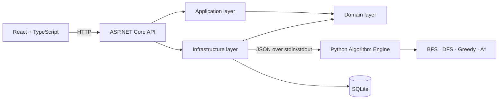

# Where is my home

**A visual pathfinding race for exploring how search algorithms make decisions.**

NavX Arena puts four classic search algorithms on the same city grid and compares the routes they find. Build a map, add traffic or obstacles, choose the racers, and watch their search unfold on the track.

## At a glance

- **Algorithms:** Breadth-First Search (BFS), Depth-First Search (DFS), Greedy Best-First Search, and A*.
- **Map editor:** place a start, finish, open road, traffic, or blocked cells.
- **Race controls:** select racers, adjust playback speed, pause, and reset.
- **Results:** compare routes, fuel cost, explored cells, and the composite score. Search duration is included in API results and contributes to the winner score.
- **Stack:** React and TypeScript frontend, ASP.NET Core API, Python search engine, and SQLite persistence.

## How the race works

Each algorithm receives the same grid, start, and goal. It returns a path, the cells it explored, the path cost, and its computation time. The frontend animates the results so you can compare both the route and the search process.

The grid uses these cell values:

| Cell | Meaning | Traversable | Cost to enter |
| --- | --- | --- | ---: |
| `1` | Open road | Yes | 1 |
| `5` | Traffic | Yes | 5 |
| `-1` | Blocked cell | No | - |

Movement is limited to up, right, down, and left. Path cost is the sum of the entered cells, excluding the start cell.

### The algorithms

| Algorithm | How it chooses the next cell | What it optimizes |
| --- | --- | --- |
| **BFS** | Uses a first-in, first-out queue and explores level by level. | Fewest moves on an unweighted grid; it does not guarantee the lowest traffic cost. |
| **DFS** | Uses a last-in, first-out stack and follows a branch deeply before backtracking. | No shortest-path or lowest-cost guarantee. Its route depends on neighbor order. |
| **Greedy** | Chooses the cell with the smallest Manhattan-distance estimate to the goal. | Direct goal-seeking; it can be misled and is not guaranteed to find the cheapest route. |
| **A\*** | Prioritizes `g + h`: cost already paid plus estimated remaining distance. | Lowest-cost route for the current grid and admissible Manhattan heuristic. |

### Score and winner

The final score combines path quality and algorithm computation time. Lower scores rank higher.

```text
score = 0.60 × normalized fuel cost
      + 0.40 × normalized search time

normalized value = (value - minimum) / (maximum - minimum)
```

The backend normalizes the valid algorithm results against the minimum and maximum in the current race. Algorithms that do not find a route are excluded from winner selection. If all values for a metric are equal, that metric contributes zero for every racer. The number of explored cells is shown as a separate statistic; it is not part of the score. Playback speed changes the on-screen animation, not the measured search time.

## Architecture



The backend follows Clean Architecture. The Python engine is launched by the infrastructure layer as a separate process and communicates through a JSON contract. On startup, the API applies pending Entity Framework Core migrations.

## Technology

- **Frontend:** React 19, TypeScript, Vite 8, Tailwind CSS 4.
- **API:** ASP.NET Core on .NET 10.
- **Algorithm engine:** Python 3 using the standard library.
- **Persistence:** Entity Framework Core with SQLite.
- **Application services:** MediatR, FluentValidation, and AutoMapper.
- **Containers:** Docker Compose.

## Getting started

### Requirements

- .NET 10 SDK
- Node.js 20.19 or newer, or 22.12 or newer, and npm
- Python 3.10 or newer on `PATH` (`python` on Windows, `python3` on Linux/macOS)
- Docker Desktop, if using the container setup

### Run with Docker

From the repository root:

```bash
docker compose up --build
```

Open [http://localhost:5000](http://localhost:5000). Docker Compose persists SQLite data in the `navx_data` named volume. Stop the app with `Ctrl+C`, or run `docker compose down` in another terminal.

### Run locally

Build the frontend assets first. From the repository root:

```bash
cd src/frontend
npm ci
npm run build
cd ../..
dotnet run --project src/backend/NavX.Api/NavX.Api.csproj --launch-profile NavX.Arena
```

Open [http://localhost:5000](http://localhost:5000). The API serves the built frontend. The launch profile uses the Development environment and port `5000`.

For frontend hot reload, keep the API running and start Vite in a second terminal:

```bash
cd src/frontend
npm run dev
```

Open [http://localhost:5173](http://localhost:5173). Vite runs the React app; API requests use the backend at `http://localhost:5000`.

On Windows, the included `navx.ps1` project menu also provides a **Run App** option.

## Configuration

The default settings are in `src/backend/NavX.Api/appsettings.json`.

| Setting | Default | Purpose |
| --- | --- | --- |
| `ConnectionStrings:DefaultConnection` | `Data Source=data/navx_arena.db;Cache=Shared` | SQLite connection string. |
| `PythonEngine:Executable` | `python` | Python executable; use `python3` on Linux/macOS when needed. |
| `PythonEngine:EnginePath` | `src/backend/NavX.AlgorithmEngine/main.py` | Entry point for the search engine. |
| `PythonEngine:TimeoutSeconds` | `10` | Maximum wait for an engine request. |

For environment-based configuration, use the standard .NET double-underscore format, for example `PythonEngine__Executable`.

## API

The API is available at `http://localhost:5000`. Interactive OpenAPI documentation is available at [`/swagger`](http://localhost:5000/swagger).

| Method | Route | Description |
| --- | --- | --- |
| `GET` | `/health` | Service health check. |
| `GET` | `/api/health` | API health check. |
| `POST` | `/api/races` | Run the selected search algorithms on a grid. |
| `GET` | `/api/races?page=1&pageSize=10` | Retrieve paginated race results. |
| `GET` | `/api/races/{id}` | Retrieve a race result. |
| `GET` | `/api/races/{id}/replay` | Retrieve replay data, including explored cells. |
| `GET` | `/api/maps` | List saved maps. |
| `GET` | `/api/maps/{id}` | Retrieve a saved map. |
| `POST` | `/api/maps` | Save a map. |
| `DELETE` | `/api/maps/{id}` | Delete a saved map. |
| `GET` | `/api/stats` | Retrieve aggregate race statistics. |

## Build and checks

Run these from the repository root unless a command says otherwise:

```bash
# Build the .NET solution and run its test suites (repository root)
dotnet build NavX.slnx
dotnet test NavX.slnx

# Check Python syntax (repository root)
python -m compileall src/backend/NavX.AlgorithmEngine
```

```bash
# Install dependencies, build, and lint the frontend (src/frontend)
npm ci
npm run build
npm run lint
```

## Repository layout

```text
.
├── Docs/                         Architecture notes and project documentation
├── data/                         Local SQLite data directory
├── src/
│   ├── backend/
│   │   ├── NavX.Api/             ASP.NET Core API and static-file hosting
│   │   ├── NavX.Application/     Use cases, commands, queries, and DTOs
│   │   ├── NavX.Domain/          Core entities, value objects, and policies
│   │   ├── NavX.Infrastructure/  SQLite, persistence, and Python process adapter
│   │   └── NavX.AlgorithmEngine/ Python CLI and pathfinding algorithms
│   └── frontend/                 React application
└── tests/
    ├── NavX.Api.IntegrationTests/
    ├── NavX.Application.Tests/
    ├── NavX.ArchitectureTests/
    └── NavX.Domain.Tests/
```

## License

No license file is currently included in this repository. Add a `LICENSE` file before redistributing the project under an open-source license.
